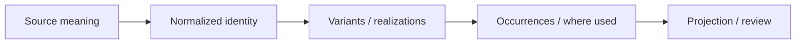
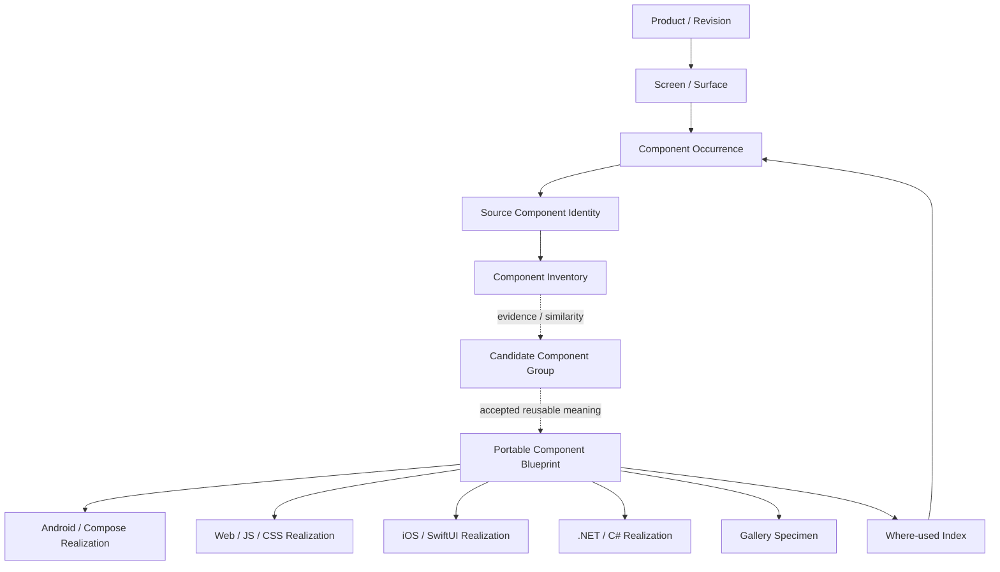
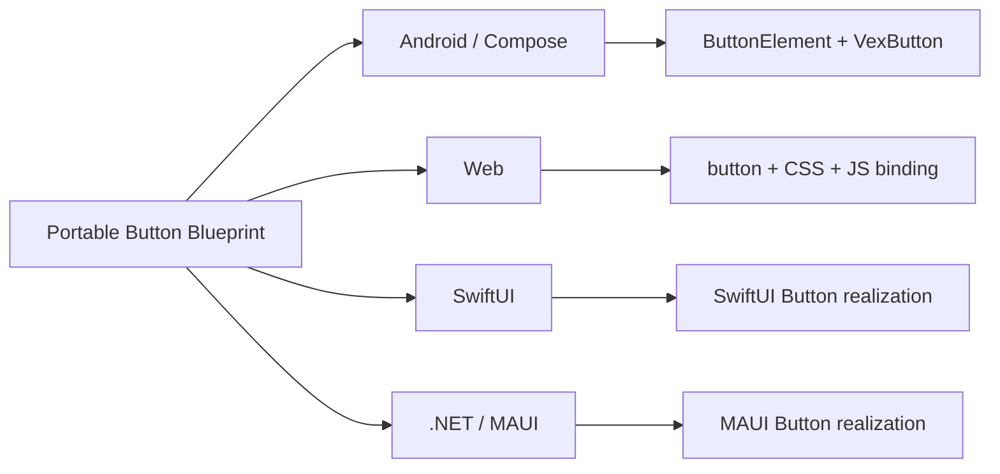

# Component Library Architecture — Portable Components, Realizations and Gallery

`[VXG RealForever]`

## 1. The localization analogy

Localization and reusable component construction share a structural pattern:



But the concrete meanings differ.

### Human language

```text
sourceStringRef
  -> EN
  -> ES
  -> JA
  -> zh-Hans
```

### Code/platform language

```text
portableComponentRef
  -> Android / Kotlin / Compose
  -> Web / HTML / CSS / JS
  -> iOS / Swift / SwiftUI
  -> .NET / C# / MAUI
```

The common architectural lesson is **stable meaning first, realizations second**.

## 2. Canonical relationship model



Source identity and portable identity are not interchangeable.

A Product may own a useful one-off component that never becomes portable.

## 3. What belongs in a component inventory

A component occurrence may need:

```text
subjectRef
revision
screenRef / surfaceRef
elementRef / componentRef
sourceComponentRef
kind
parentRef
slot / placement
inputs / parameters
children / slots
state relationship
control / intent relationship
style / theme relationship
layout constraints
localization bindings
accessibility bindings
source paths
example / Gallery refs
proof / currentness
```

Not every component uses every field.

The contract should keep absence explicit rather than manufacturing symmetry.

## 4. Candidate grouping vs accepted portable components

Two source components may look the same while owning different meaning.

Example:

```text
Button("Delete")
  destructive product action

Button("Close")
  typed presentation dismissal
```

Both may use one visual Button realization, but their semantic relationships differ.

Likewise two visually different controls may realize the same portable relationship under platform convention.

Therefore:

```text
SAME_RENDERER
!= SAME_SEMANTIC_COMPONENT

SAME_SEMANTIC_ROLE
!= SAME_PLATFORM_PRESENTATION
```

A candidate grouper may use:

- component kind;
- stable role;
- child/slot topology;
- parameter signature;
- state/control relationship;
- layout signature;
- style/theme tokens;
- localization/accessibility shape;
- platform requirements.

It suggests convergence; it does not create it.

## 5. Portable Component Blueprint

An accepted portable component Blueprint should answer only what must survive a target change.

Conceptual shape:

```text
componentRef
purpose
roles
slots
inputs
states / presentation states
controls / intents
constraints
localization slots
accessibility requirements
realization expectations
proof expectations
```

It should not prescribe framework details such as:

```text
Modifier
remember
StateFlow
CSS flex
SwiftUI @State
MAUI BindableProperty
```

unless those details are actually part of a target realization rather than portable meaning.

## 6. Target realization

Each target realization binds portable meaning to framework-native source.



A realization may carry:

```text
targetRef
language
framework
source refs
parameter mapping
slot mapping
state mapping
event/control mapping
layout/style mapping
unsupported/held properties
proof
```

## 7. Android patient zero

Current Android already separates reusable identity and Compose realization.

Examples:

```text
ButtonElement / ToggleElement / TextElement / ...
        ↓
ElementCells / VexComposeCells
        ↓
GalleryScreen / ElementsGallery
        ↓
real Product occurrences
```

This is a stronger starting point than decompiling arbitrary UI because:

- element identity is explicit;
- containment is registered;
- intents are typed;
- localization resources are linked;
- Gallery specimens already exist;
- Screen Lens already projects many of the relationships.

A1 should reuse those sources rather than inventing another Android component registry.

## 8. Gallery as a human workspace

The Gallery should answer:

> What do we already know how to build?

A compact default card might show:

```text
Action Button
Portable · 4 realizations

States
default · disabled · pressed

Used in
Android 18
Prod 7
Stream 4

[Open specimen] [Where used] [Realizations]
```

Expanded detail may show:

```text
Meaning
Slots / parameters
States / variants
Localization
Accessibility
Behavior / intent relationship
Target realizations
Source/proof
Construction brief
```

Progressive disclosure should follow the same human-workflow lesson as Localization Architecture.

## 9. Reverse where-used

The system should be bidirectional.

```text
Component
-> all Products / Screens / Elements using it

Occurrence
-> source implementation
-> candidate / portable component
-> target realization

Target realization
-> every portable component using that realization shape
```

This avoids treating a sample file as the only way to learn reuse.

## 10. Code-language conversion

The useful long-term mechanism is not arbitrary translation of source syntax.

Preferred:

```text
accepted portable component Blueprint
        ↓
target realization mapping
        ↓
target-native constructor / template / reference source
        ↓
compiler + semantic + native proof
```

This can become deterministic for well-earned components.

```text
KOTLIN_SOURCE
  != canonical input to a Swift/C# translator
```

Android source may be evidence used to **extract** the portable Blueprint initially, but once accepted, target construction should descend from portable meaning rather than repeatedly reinterpret Android.

## 11. Reuse of Blueprint Source-of-Truth lineage

The predecessor VexLife Blueprint Source-of-Truth practicum already established:

```text
CODE != INTENTION
REPRESENTATION != CANONICAL_MEANING
GENERATED_SOURCE != NATIVE_CONFORMANCE
COMPILER_PASS != SEMANTIC_EQUIVALENCE
```

This Project operationalizes those laws at component-library scale.

It does not reopen the old Play/Pause practicum or require its parked MAUI/Mac edge to resume.

## 12. Relationship to Screen Lens

Screen Lens already gives us:

- stable Product / Screen / Element identity;
- containment;
- typed presentation/navigation;
- behavior/depth relationships;
- source/currentness;
- selection/search/where-used interaction grammar.

Component Library Architecture can consume that projection as one source of occurrence relationships.

The library should not duplicate Screen Lens.

Conceptually:

```text
Screen Lens
  answers: what is this Product UI and what relationships does it have?

Component Library
  answers: which of those structures are reusable, where else do they occur,
           and how is the accepted reusable meaning realized per target?
```

## 13. Component Library itself is projectable

The Gallery/Library is a Vextreme Product.

As it is built:

```text
stable Screens / Elements
-> its own localization bindings
-> its own component occurrences
-> Screen Lens projection
-> component inventory
-> self-where-used
```

No privileged admin exception.

## 14. Paired implementation slices

Avoid building a library UI disconnected from the reusable contract.

```text
Slice 1
Android component inventory
+ first portable Gallery container identity

Slice 2
component search / where-used
+ projectable Gallery controls

Slice 3
portable component candidate/detail
+ component relationship projection

Slice 4
target realization tabs
+ currentness / proof mapping

Slice 5
construction brief / export
+ deterministic target mapping where earned

Slice 6
self-use / self-projection / localization proof
```

## 15. First completion test

Before a big Gallery UI exists, machine data should answer:

```text
Given source component X:
  where is it used?
  what relationships/slots/states does it expose?

Given occurrence Y:
  what reusable component/candidate does it belong to?

Given portable component Z:
  which target realizations exist?
  which are current / proven / held?

Given target T:
  what accepted component patterns can be constructed without re-reading old Product source?
```

If a future worker still needs to grep historical source just to learn an accepted reusable component relationship, the library has not yet achieved its purpose.

<!-- [VXG RealForever][VEXWORK][COMPONENT-LIBRARY-ARCHITECTURE][PORTABLE-REALIZATIONS] -->
