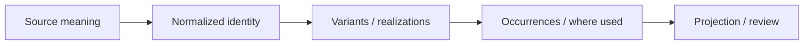
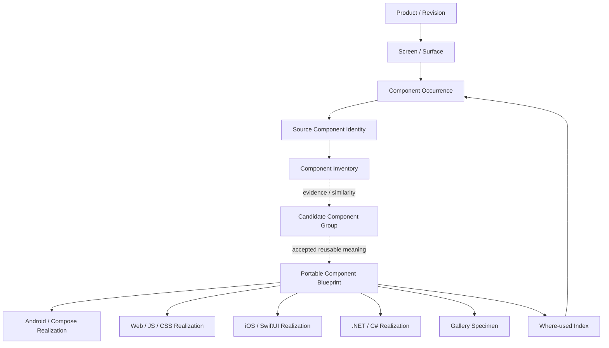
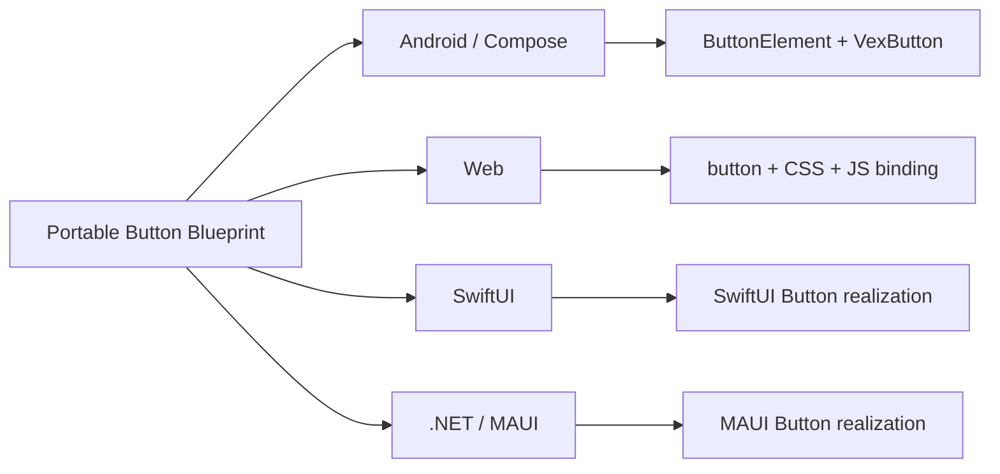

# Component Library Architecture — Portable Components, Realizations and Gallery

`[VXG RealForever]`

## 1. The localization analogy

Localization and reusable component construction share a structural pattern:



But the concrete meanings differ.

### Human language

```text
sourceStringRef
  -> EN
  -> ES
  -> JA
  -> zh-Hans
```

### Code/platform language

```text
portableComponentRef
  -> Android / Kotlin / Compose
  -> Web / HTML / CSS / JS
  -> iOS / Swift / SwiftUI
  -> .NET / C# / MAUI
```

The common architectural lesson is **stable meaning first, realizations second**.

## 2. Canonical relationship model



Source identity and portable identity are not interchangeable.

A Product may own a useful one-off component that never becomes portable.

## 3. What belongs in a component inventory

A component occurrence may need:

```text
subjectRef
revision
screenRef / surfaceRef
elementRef / componentRef
sourceComponentRef
kind
parentRef
slot / placement
inputs / parameters
children / slots
state relationship
control / intent relationship
style / theme relationship
layout constraints
localization bindings
accessibility bindings
source paths
example / Gallery refs
proof / currentness
```

Not every component uses every field.

The contract should keep absence explicit rather than manufacturing symmetry.

## 4. Candidate grouping vs accepted portable components

Two source components may look the same while owning different meaning.

Example:

```text
Button("Delete")
  destructive product action

Button("Close")
  typed presentation dismissal
```

Both may use one visual Button realization, but their semantic relationships differ.

Likewise two visually different controls may realize the same portable relationship under platform convention.

Therefore:

```text
SAME_RENDERER
!= SAME_SEMANTIC_COMPONENT

SAME_SEMANTIC_ROLE
!= SAME_PLATFORM_PRESENTATION
```

A candidate grouper may use:

- component kind;
- stable role;
- child/slot topology;
- parameter signature;
- state/control relationship;
- layout signature;
- style/theme tokens;
- localization/accessibility shape;
- platform requirements.

It suggests convergence; it does not create it.

## 5. Portable Component Blueprint

### Ownership correction — portable does not mean globally semantic

A3 pressure sharpens the term **portable**.

A recurring component relationship may be portable across Products/targets without becoming a new
global semantic owner for those Products.

```text
Product meaning
-> remains Product-owned

portable relationship contract
-> preserves the minimum relationship that must survive representation change

reusable construction/proof machinery
-> may be shared when the same executable invariant is genuinely repeated
```

This follows the existing cross-repository architecture law:

```text
SAME FIRST-PRINCIPLE RELATIONSHIP
!= SAME DOMAIN
!= SAME OWNER
!= SAME IMPLEMENTATION
```

So a future `LocalSelection` or `StableRepeatedItems` contract must carry source-owned refs and
boundaries; it must not absorb the feature/domain state merely because several Products can use the
same construction relationship.


An accepted portable component Blueprint should answer only what must survive a target change.

The current accepted A3 spine is:

```text
Identity-addressed presentation tree
Typed containment / source parent-child relationship
Semantic control binding
Frame / Seam / Region / Allocation
Stable Repeated Items
```

Local Selection remains HELD because current VexLife-Prod does not yet own one compiler-visible
default/current selection contract and production refactoring is intentionally deferred.

These acceptances mean the smallest relationship law survived Product/target pressure; they do not
promote any one renderer implementation or native proof into portable meaning.

```text
A3 ACCEPTED_PORTABLE
!= A4 TARGET_NATIVE_ACCEPTED
```


Conceptual shape:

```text
componentRef
purpose
roles
slots
inputs
states / presentation states
controls / intents
constraints
localization slots
accessibility requirements
realization expectations
proof expectations
```

It should not prescribe framework details such as:

```text
Modifier
remember
StateFlow
CSS flex
SwiftUI @State
MAUI BindableProperty
```

unless those details are actually part of a target realization rather than portable meaning.

## 6. Target realization

Each target realization binds portable meaning to framework-native source.



A realization may carry:

```text
targetRef
language
framework
source refs
parameter mapping
slot mapping
state mapping
event/control mapping
layout/style mapping
unsupported/held properties
proof
```

## 7. Android patient zero

Current Android already separates reusable identity and Compose realization.

Examples:

```text
ButtonElement / ToggleElement / TextElement / ...
        ↓
ElementCells / VexComposeCells
        ↓
GalleryScreen / ElementsGallery
        ↓
real Product occurrences
```

This is a stronger starting point than decompiling arbitrary UI because:

- element identity is explicit;
- containment is registered;
- intents are typed;
- localization resources are linked;
- Gallery specimens already exist;
- Screen Lens already projects many of the relationships.

A1 should reuse those sources rather than inventing another Android component registry.

## 8. Gallery + Studio as a human workspace

The lived A5 correction is that a Gallery cannot center the occurrence index.

The human question is:

> What do we already know how to build, what is the thing like by itself, and what can I make with it?

The default relationship should be:

```text
component source family
-> one real source occurrence as an isolated specimen
-> actual source examples / styles / conditions
-> relationship inspector
-> place into Studio
-> deterministic composition blueprint
```

Where-used, target realizations and proof remain evidence behind the selected specimen.

### Isolated specimen

A specimen is drawn from one current source occurrence and its projected relationships:

```text
kind
label
style / slot / layer / text role
children
intent / action / pathway
visibility / presence / condition evidence
localization bindings
accessibility projection state
```

The specimen is a relationship projection, not native pixel parity.

```text
SOURCE-GROUNDED SPECIMEN
!= SCREENSHOT
!= TARGET-NATIVE ACCEPTANCE
```

Cycling examples means cycling actual source occurrences. The Gallery does not invent framework
states merely because a control type could theoretically have them.

### Studio

The Studio treats component specimens like buildable furniture: a person can place an item at the
composition root or inside a selected container, inspect the resulting structure, reorder it and
remove it.

The Studio composition is not stored as pixels. It is stored as relationships.

```text
vexboard.component-studio-blueprint/v1

composition node
  nodeRef
  parentNodeRefOrNull
  siblingOrder

  exact source occurrence coordinate
  presentation relationships
  behavior relationships

  portability disposition
    PORTABLE_RELATIONSHIP_AVAILABLE
    PORTABILITY_HELD
    SOURCE_BOUND

  accepted portable candidate refs
  target realization refs
```

The artifact is deterministic and explicitly non-executing:

```text
aiRequired = false
effects = false
executionAuthority = NONE
```

This is the bridge from human composition to future target construction without making an AI
reconstruct intent from screenshots, prose or historical source.

A6 consumes the Studio Blueprint through target adapters. Therefore:

```text
A5 Studio Blueprint
!= generated Compose / SwiftUI / Web source

A6 target construction
-> adapter
-> target-native source / reference artifact
-> target proof
```

## 9. Reverse where-used

The system should be bidirectional.

```text
Component
-> all Products / Screens / Elements using it

Occurrence
-> source implementation
-> candidate / portable component
-> target realization

Target realization
-> every portable component using that realization shape
```

This avoids treating a sample file as the only way to learn reuse.

## 10. Typed Blueprint compiler and target adapters

The accepted VexLife-Prod lineage sharpens the earlier language-neutral contract idea.

The portable relationship **meaning** remains framework-neutral, but its strongest authoring form may
be Kotlin because sealed types, value classes, nested DSLs and exhaustive `when` branches can bind
relationships more safely than loose configuration.

Current accepted precedent:

```text
VexScreenBlueprint
+ VexUiElementRef
+ VexWeb sealed relationship grammar
+ VexWebAuthoring Kotlin DSL
        ↓
VexWebArtifacts
        ↓
HTML / CSS / JS
+ semantic manifest
```

This proves the architecture pattern:

```text
TYPED KOTLIN AUTHORING
!= COMPOSE

RELATIONSHIP SOURCE
!= TARGET GENERATOR

GENERATED TARGET SOURCE
!= AUTHORING SOURCE

TARGET SEMANTIC MANIFEST
!= CANONICAL WRITEBACK
```

The Component Library should generalize that pattern rather than invent a second generic Kotlin UI
hierarchy.

A future iOS leg should look like:

```text
accepted portable component relationships
-> Kotlin Blueprint / normalized IR
-> SwiftUI adapter
-> Swift-native source + semantic manifest
-> Swift compile / native proof
-> iOS Screen Lens
-> Component Library parity observation
```

See [KOTLIN-BLUEPRINT.md](./KOTLIN-BLUEPRINT.md).

## 11. Code-language conversion

The useful long-term mechanism is not arbitrary translation of source syntax.

Preferred:

```text
accepted portable component Blueprint
        ↓
target realization mapping
        ↓
target-native constructor / template / reference source
        ↓
compiler + semantic + native proof
```

This can become deterministic for well-earned components.

```text
KOTLIN_SOURCE
  != canonical input to a Swift/C# translator
```

Android source may be evidence used to **extract** the portable Blueprint initially, but once accepted, target construction should descend from portable meaning rather than repeatedly reinterpret Android.

## 12. Reuse of Blueprint Source-of-Truth lineage

The predecessor VexLife Blueprint Source-of-Truth practicum already established:

```text
CODE != INTENTION
REPRESENTATION != CANONICAL_MEANING
GENERATED_SOURCE != NATIVE_CONFORMANCE
COMPILER_PASS != SEMANTIC_EQUIVALENCE
```

This Project operationalizes those laws at component-library scale.

It does not reopen the old Play/Pause practicum or require its parked MAUI/Mac edge to resume.

## 13. Relationship to Screen Lens

Screen Lens already gives us:

- stable Product / Screen / Element identity;
- containment;
- typed presentation/navigation;
- behavior/depth relationships;
- source/currentness;
- selection/search/where-used interaction grammar.

Component Library Architecture can consume that projection as one source of occurrence relationships.

The library should not duplicate Screen Lens.

Conceptually:

```text
Screen Lens
  answers: what is this Product UI and what relationships does it have?

Component Library
  answers: which of those structures are reusable, where else do they occur,
           and how is the accepted reusable meaning realized per target?
```

## 14. Component Library itself is projectable

The Gallery/Library is a Vextreme Product.

As it is built:

```text
stable Screens / Elements
-> its own localization bindings
-> its own component occurrences
-> Screen Lens projection
-> component inventory
-> self-where-used
```

No privileged admin exception.

## 15. Paired implementation slices

Avoid building a Library UI disconnected from the reusable relationship contract.

```text
Slice 1
source inventory
+ first isolated source-grounded specimen

Slice 2
specimen example cycling / edge evidence
+ where-used / Screen Lens deep link

Slice 3
portable relationship / realization / proof inspector
+ explicit source-bound / held states

Slice 4
Studio composition tree
+ parent / order / containment preservation

Slice 5
deterministic Studio Blueprint export / import
+ no-AI reconstruction contract

Slice 6 (A6)
Studio Blueprint -> target adapter
+ target-native construction / proof

Slice 7 (A7)
self-use / self-projection / localization proof
```

## 16. A1 observed inventory implementation

The first implementation deliberately stops **before** portable-component acceptance.

```text
Android Main @ d857a92371555472e0303b18eadf353da2a868d6
  Screen Lens
  + Localization Inventory
        ↓
vexboard.component-inventory/v1
        ↓
observed source family
  kind
  occurrence / where-used
  parent + direct children
  style / slot / layer / text role
  intent / action / pathway / navigation
  localization resource + sourceString refs
  realization realizedBy / realizedIn
  explicit accessibility projection state
```

Current candidate census:

```text
15 source families
274 occurrences
13 Screens
13 shell/chrome occurrences
190 localization-linked occurrences
121 realization-linked occurrences
0 accessibility-projected occurrences
```

The zero is useful truth: accessibility meaning is not inferred from Material/Compose component type.
It remains visible as `NOT_PROJECTED` until the rightful Product source/proof is connected.

A1 source-family identities are intentionally Product-bound:

```text
component.source-family.vexlife-android.button
component.source-family.vexlife-android.dialog
...
```

They support discovery and where-used only.

```text
SOURCE_FAMILY
!= CANDIDATE_PORTABLE_COMPONENT
!= ACCEPTED_PORTABLE_COMPONENT
```

The human projection at `vexboard/components.html` is allowed to exist before A3 so the inventory
has one stable place to become useful. It must continue labeling source families as observed and
portability as unclassified until later cross-Product evidence changes that truth.

Production refactor findings are isolated in `TECH-DEBT.md`; A1 does not mutate Android source.

## 17. First completion test

Before a big Gallery UI exists, machine data should answer:

```text
Given source component X:
  where is it used?
  what relationships/slots/states does it expose?

Given occurrence Y:
  what reusable component/candidate does it belong to?

Given portable component Z:
  which target realizations exist?
  which are current / proven / held?

Given target T:
  what accepted component patterns can be constructed without re-reading old Product source?
```

If a future worker still needs to grep historical source just to learn an accepted reusable component relationship, the library has not yet achieved its purpose.

<!-- [VXG RealForever][VEXWORK][COMPONENT-LIBRARY-ARCHITECTURE][PORTABLE-REALIZATIONS] -->
