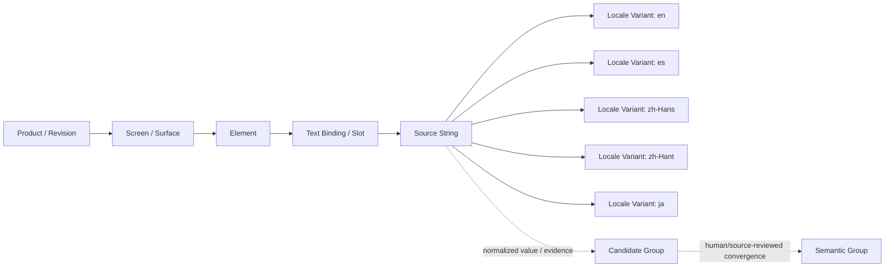
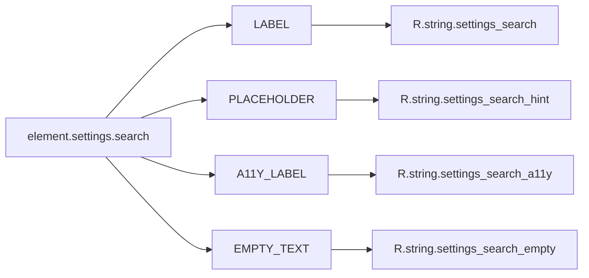
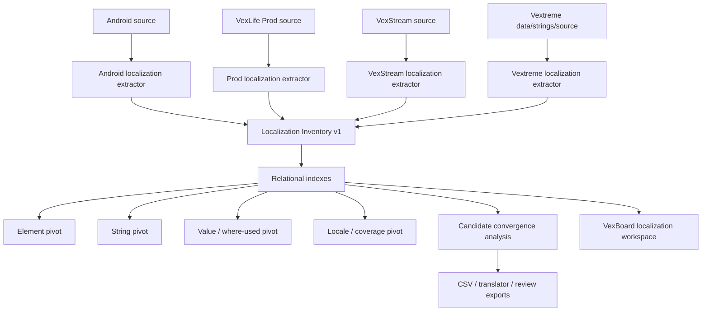

# Localization Architecture — Relational Model and Projections

`[VXG RealForever]`

## 1. Why this shape

Localization is not only a table of translations. The useful truth is relational:

- which visible/semantic element consumes text;
- which text slot it consumes it through;
- which Product-owned source string supplies that text;
- which locale variants exist;
- where one source string is reused;
- where multiple source strings happen to share the same source-language value;
- whether those apparently duplicated strings actually mean the same thing.

The architecture therefore preserves stable source identities first and treats regrouping as a projection/analysis concern.

## 2. Canonical relationship model



The key distinction:

```text
stable source identity
  !=
derived grouping identity
```

A Candidate Group may be split, merged, renamed or discarded without rewriting the Product's source string identity.

## 3. Text Binding / Slot

One Element may carry several independently meaningful pieces of human text.



The normalized occurrence therefore needs at least:

```text
subjectRef
revision
screenRef / surfaceRef
elementRef
textRole
sourceStringRef
sourceLocale
sourceValue
sourcePath
sourceLineOrNull
formatSignature
```

The slot prevents `one element = one string` from becoming an accidental architecture law.

## 4. Same graph, different pivots

### Element-first

```text
VexLife Android
  screen.settings
    element.settings.language
      LABEL
        android:R.string.settings_language
          en = "Language"
          es = ...
          ja = ...
```

Question answered:

> What text participates in this Product/Screen/Element?

### String-first / reverse where-used

```text
android:R.string.settings_language
  en = "Language"

  occurrences
    -> element.settings.language / LABEL
    -> element.onboarding.language / LABEL
    -> element.profile.language / LABEL
```

Question answered:

> Which element IDs carry this source string or a selected subset of strings?

### Value-first / duplicate discovery

```text
source value = "Settings"

candidate members
  android:R.string.nav_settings
  prod:workspace.settings
  vexstream:settings.title
```

Question answered:

> Which independently-owned strings currently render the same source-language value?

This is discovery only. `"Settings"` is not the canonical primary key.

### Locale-first

```text
ja
  translated
    ...
  missing
    ...
  complete scopes
    ...
```

Question answered:

> What is complete, missing, divergent or fallback-bound for this locale?

## 5. Why value cannot be identity

```text
EN "Open"
  -> file action
     ES "Abrir"

EN "Open"
  -> state/status
     ES "Abierto"
```

Same English bytes, different meaning and different translation.

The duplicate analyzer should therefore retain every source string as a separate member and attach evidence:

```text
EXACT_SOURCE_VALUE
SAME_TEXT_ROLE
DIFFERENT_TEXT_ROLE
SAME_DOMAIN
DIFFERENT_DOMAIN
SAME_FORMAT_SIGNATURE
DIFFERENT_FORMAT_SIGNATURE
SAME_TRANSLATION_SET
DIVERGENT_TRANSLATION_SET
```

Only a later accepted semantic decision may create a `semanticGroupRef`.

## 6. Format signatures

Parameterized strings participate in identity review through their argument shape.

Examples:

```text
"Connected to %1$s"
  -> Connected to {STRING_1}

"%1$d of %2$d songs on this phone"
  -> {INT_1} of {INT_2} songs on this phone
```

The normalized inventory should retain both the original source value and a platform-neutral format signature. Grouping incompatible signatures is a strong separation signal.

## 7. Locale identity

Do not collapse script distinctions merely because a Product source uses a shorter language code.

```text
sourceLocale      canonicalLocale
zh          ->    zh-Hans   only when current source/runtime mapping proves that meaning
zh-Hant     ->    zh-Hant
ja          ->    ja
```

The normalized graph may carry both source and canonical locale identity.

VexWork already has Chinese script discrimination in `experience-graph-localization.mjs`; reuse that learned boundary rather than reducing every Chinese variant to `zh`.

## 8. Source adapters and normalized inventory



Different Product source architecture is allowed.

The shared layer standardizes questions, not implementation style.

## 9. Android patient zero

Android is the first proving ground because current source already exposes the needed relationship:

```text
registered UI element
  elementId
  labelRes / textRes
        +
app/src/main/res/values/strings.xml
        =
elementRef -> textRole -> R.string.<id> -> English/default value
```

The existing VexBoard Android adapter already parses:

- registered refs / element IDs;
- `labelRes` / `textRes`;
- default Android string resources;
- resolved human labels.

The first implementation should preserve the source string ID and binding instead of throwing that relationship away after resolving the display label.

It should not create a second Android source parser unless the current reader proves incapable of carrying the relationship.

## 10. Vextreme as an existing mature source owner

Vextreme already has:

```text
data/strings/source/*
lib/strings-check.js
lib/strings-compile.js
lib/strings-export.js
lib/strings-import.js
data/strings/compiled/*
```

and explicitly treats its keyed string registry as an element identity layer.

Localization Architecture should consume/project that truth, not replace it with a VexBoard-owned master translation database.

## 11. Materialized views / CSVs

CSV remains useful as a human/tool interchange surface.

### Occurrence view

```text
Project | Screen | Element ID | Text role | Source string ID | EN | ES | ZH-Hans | JA | ...
```

### Source-string view

```text
Source string ID | Source value | Projects | Element refs | Roles | format signature | locale variants...
```

### Duplicate-candidate view

```text
Candidate group
Source string ID
Source value
Projects
Element refs
Text roles
Format signature
Evidence
Disposition
EN | ES | ZH-Hans | ZH-Hant | JA | ...
```

These are projections generated from the relational inventory.

```text
CSV_EXPORT != SOURCE_OWNER
```

## 12. VexBoard projection

Localization should become another orthogonal Lens dimension:

```text
Project
x Revision
x Screen
x Expression
x Presentation
x Locale
x Face
```

not:

```text
English Screen Lens
Spanish Screen Lens
Japanese Screen Lens
...
```

A separate localization sidecar is likely healthier than embedding every locale value into every element of the main Screen Lens payload:

```text
<subject>.screen-lens.json
<subject>.localization.json
```

Both bind the same Product revision; the localization sidecar is loaded when the localization dimension/workspace needs it.

This remains a design direction until the Android patient zero proves the minimum contract.

## 13. Content-management behavior

The eventual VexBoard workspace may feel like a string CMS, but its ownership is bounded:

```text
VexBoard may:
  inspect
  reverse-query
  group
  split candidate groups
  compare locales
  expose coverage
  export review CSVs
  preserve accepted semantic grouping evidence

VexBoard does not automatically:
  rename Product source keys
  merge Product string identities
  write translations into Product source
  create a global localization scheduler
```

Source-owner writeback/import is a later, separately admitted effect.

## 14. First completion test

Before building the CMS UI, the Android patient zero should be able to answer from generated machine data alone:

```text
Given elementRef X:
  which text slots exist?
  which source string IDs supply them?
  what is the default/source value?

Given sourceStringRef Y:
  which element refs and slots consume it?

Given source value Z:
  which source strings share it?
  what contextual evidence suggests shared vs separate meaning?
```

If those questions require source archaeology after inventory generation, the normalized contract is incomplete.

<!-- [VXG RealForever][VEXWORK][LOCALIZATION-ARCHITECTURE][RELATIONAL-MODEL] -->
