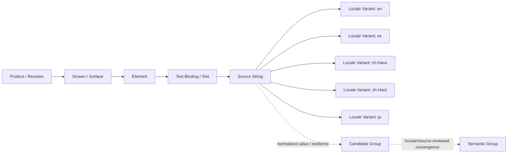
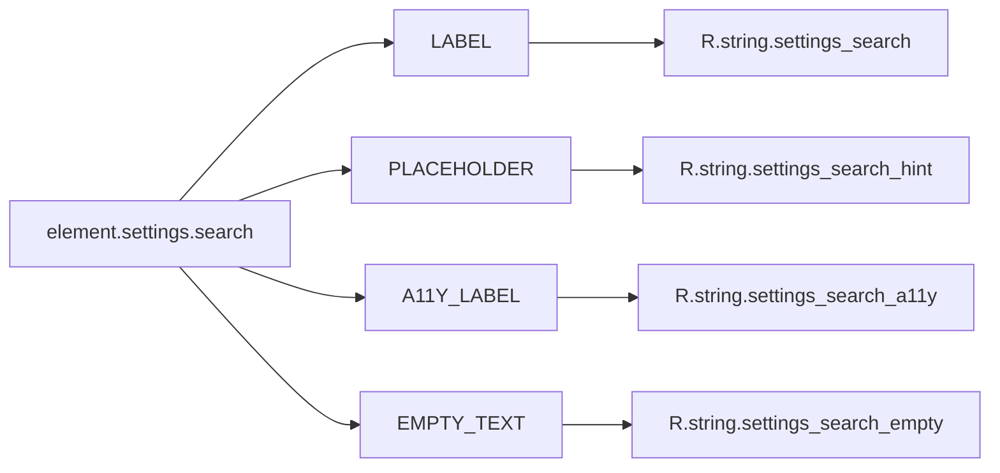
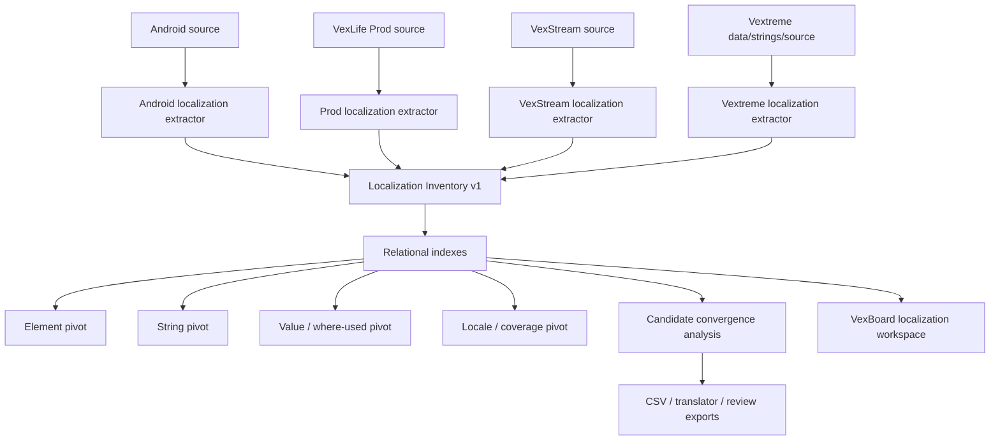
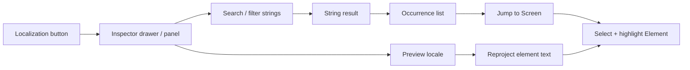
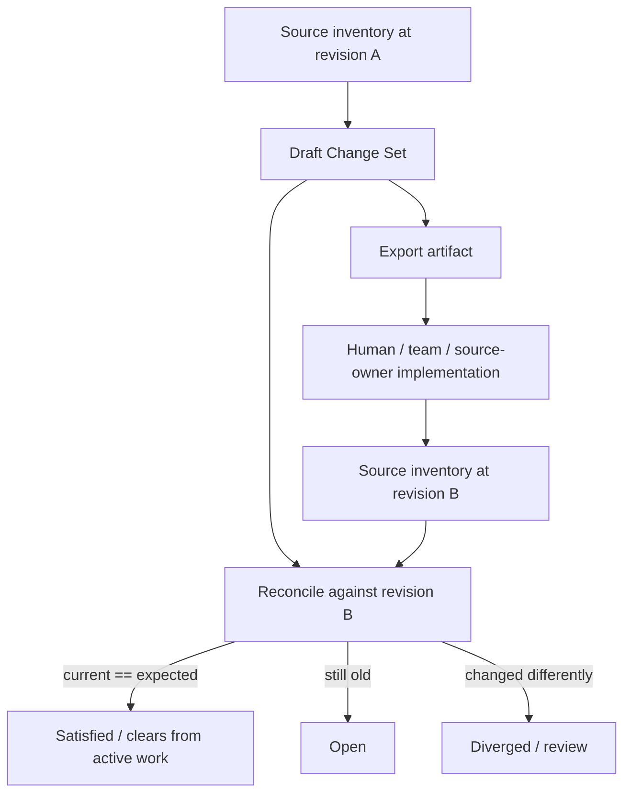

# Localization Architecture — Relational Model and Projections

`[VXG RealForever]`

## 1. Why this shape

Localization is not only a table of translations. The useful truth is relational:

- which visible/semantic element consumes text;
- which text slot it consumes it through;
- which Product-owned source string supplies that text;
- which locale variants exist;
- where one source string is reused;
- where multiple source strings happen to share the same source-language value;
- whether those apparently duplicated strings actually mean the same thing.

The architecture therefore preserves stable source identities first and treats regrouping as a projection/analysis concern.

## 2. Canonical relationship model



The key distinction:

```text
stable source identity
  !=
derived grouping identity
```

A Candidate Group may be split, merged, renamed or discarded without rewriting the Product's source string identity.

## 3. Text Binding / Slot

One Element may carry several independently meaningful pieces of human text.



The normalized occurrence therefore needs at least:

```text
subjectRef
revision
screenRef / surfaceRef
elementRef
textRole
sourceStringRef
sourceLocale
sourceValue
sourcePath
sourceLineOrNull
formatSignature
```

The slot prevents `one element = one string` from becoming an accidental architecture law.

## 4. Same graph, different pivots

### Element-first

```text
VexLife Android
  screen.settings
    element.settings.language
      LABEL
        android:R.string.settings_language
          en = "Language"
          es = ...
          ja = ...
```

Question answered:

> What text participates in this Product/Screen/Element?

### String-first / reverse where-used

```text
android:R.string.settings_language
  en = "Language"

  occurrences
    -> element.settings.language / LABEL
    -> element.onboarding.language / LABEL
    -> element.profile.language / LABEL
```

Question answered:

> Which element IDs carry this source string or a selected subset of strings?

### Value-first / duplicate discovery

```text
source value = "Settings"

candidate members
  android:R.string.nav_settings
  prod:workspace.settings
  vexstream:settings.title
```

Question answered:

> Which independently-owned strings currently render the same source-language value?

This is discovery only. `"Settings"` is not the canonical primary key.

### Locale-first

```text
ja
  translated
    ...
  missing
    ...
  complete scopes
    ...
```

Question answered:

> What is complete, missing, divergent or fallback-bound for this locale?

## 5. Why value cannot be identity

```text
EN "Open"
  -> file action
     ES "Abrir"

EN "Open"
  -> state/status
     ES "Abierto"
```

Same English bytes, different meaning and different translation.

The duplicate analyzer should therefore retain every source string as a separate member and attach evidence:

```text
EXACT_SOURCE_VALUE
SAME_TEXT_ROLE
DIFFERENT_TEXT_ROLE
SAME_DOMAIN
DIFFERENT_DOMAIN
SAME_FORMAT_SIGNATURE
DIFFERENT_FORMAT_SIGNATURE
SAME_TRANSLATION_SET
DIVERGENT_TRANSLATION_SET
```

Only a later accepted semantic decision may create a `semanticGroupRef`.

## 6. Format signatures

Parameterized strings participate in identity review through their argument shape.

Examples:

```text
"Connected to %1$s"
  -> Connected to {STRING_1}

"%1$d of %2$d songs on this phone"
  -> {INT_1} of {INT_2} songs on this phone
```

The normalized inventory should retain both the original source value and a platform-neutral format signature. Grouping incompatible signatures is a strong separation signal.

## 7. Locale identity

Do not collapse script distinctions merely because a Product source uses a shorter language code.

```text
sourceLocale      canonicalLocale
zh          ->    zh-Hans   only when current source/runtime mapping proves that meaning
zh-Hant     ->    zh-Hant
ja          ->    ja
```

The normalized graph may carry both source and canonical locale identity.

VexWork already has Chinese script discrimination in `experience-graph-localization.mjs`; reuse that learned boundary rather than reducing every Chinese variant to `zh`.

## 8. Source adapters and normalized inventory



Different Product source architecture is allowed.

The shared layer standardizes questions, not implementation style.

## 9. Android patient zero

Android is the first proving ground because current source already exposes the needed relationship:

```text
registered UI element
  elementId
  labelRes / textRes
        +
app/src/main/res/values/strings.xml
        =
elementRef -> textRole -> R.string.<id> -> English/default value
```

The existing VexBoard Android adapter already parses:

- registered refs / element IDs;
- `labelRes` / `textRes`;
- default Android string resources;
- resolved human labels.

The first implementation should preserve the source string ID and binding instead of throwing that relationship away after resolving the display label.

It should not create a second Android source parser unless the current reader proves incapable of carrying the relationship.

## 10. Vextreme as an existing mature source owner

Vextreme already has:

```text
data/strings/source/*
lib/strings-check.js
lib/strings-compile.js
lib/strings-export.js
lib/strings-import.js
data/strings/compiled/*
```

and explicitly treats its keyed string registry as an element identity layer.

Localization Architecture should consume/project that truth, not replace it with a VexBoard-owned master translation database.

## 11. Materialized views / CSVs

CSV remains useful as a human/tool interchange surface.

### Occurrence view

```text
Project | Screen | Element ID | Text role | Source string ID | EN | ES | ZH-Hans | JA | ...
```

### Source-string view

```text
Source string ID | Source value | Projects | Element refs | Roles | format signature | locale variants...
```

### Duplicate-candidate view

```text
Candidate group
Source string ID
Source value
Projects
Element refs
Text roles
Format signature
Evidence
Disposition
EN | ES | ZH-Hans | ZH-Hant | JA | ...
```

These are projections generated from the relational inventory.

```text
CSV_EXPORT != SOURCE_OWNER
```

## 12. VexBoard projection

Localization should become another orthogonal Lens dimension:

```text
Project
x Revision
x Screen
x Expression
x Presentation
x Locale
x Face
```

not:

```text
English Screen Lens
Spanish Screen Lens
Japanese Screen Lens
...
```

A separate localization sidecar is likely healthier than embedding every locale value into every element of the main Screen Lens payload:

```text
<subject>.screen-lens.json
<subject>.localization.json
```

Both bind the same Product revision; the localization sidecar is loaded when the localization dimension/workspace needs it.

This remains a design direction until the Android patient zero proves the minimum contract.

## 13. Content-management behavior

The eventual VexBoard workspace may feel like a string CMS, but its ownership is bounded:

```text
VexBoard may:
  inspect
  reverse-query
  group
  split candidate groups
  compare locales
  expose coverage
  export review CSVs
  preserve accepted semantic grouping evidence

VexBoard does not automatically:
  rename Product source keys
  merge Product string identities
  write translations into Product source
  create a global localization scheduler
```

Source-owner writeback/import is a later, separately admitted effect.

## 14. First completion test

Before building the CMS UI, the Android patient zero should be able to answer from generated machine data alone:

```text
Given elementRef X:
  which text slots exist?
  which source string IDs supply them?
  what is the default/source value?

Given sourceStringRef Y:
  which element refs and slots consume it?

Given source value Z:
  which source strings share it?
  what contextual evidence suggests shared vs separate meaning?
```

If those questions require source archaeology after inventory generation, the normalized contract is incomplete.


## 15. Two UI surfaces over one localization model

The current Screen Lens already separates frequent contextual inspection from broader navigation. Localization should follow the same pattern.

### Contextual surface — Localization Inspector

On a Product Screen Lens, the current top-bar `Related N` slot is a good home for a **Localization** control because it is already a secondary inspector affordance and localization is directly relevant to the element being inspected.

```text
VexBoard | Product | Stable/Main | Source | Search | Screen map | Localization | Legend | Colors
```

Related boards remain useful provenance but do not need the same top-level prominence. Preserve them under the Product menu, overflow, or another secondary information surface rather than deleting their meaning.

The Localization Inspector is scoped to the current subject/revision and should expose:

```text
Preview locale
Search / filter strings
Current element bindings
Where used
Missing / fallback status
Open in Localization Workspace
```

Changing Preview Locale changes only the VexBoard projection.

```text
VEXBOARD_PREVIEW_LOCALE != PRODUCT_RUNTIME_SELECTED_LOCALE
```

A later live runtime control may be admitted separately when a Product exposes lawful language-selection effects.

### Global surface — Localization Workspace

The full content-management system belongs in its own VexBoard container, for example a `Localization` entry adjacent to `Projects`.

It operates across subjects and is optimized for string-first/value-first/locale-first work rather than Screen topology:

```text
Projects     -> Product / Screen Lens entry
Localization -> cross-Product string/content workspace
```

Both surfaces consume the same localization inventory and relationship indexes.

```text
LOCALIZATION INSPECTOR
  focused contextual projection

LOCALIZATION WORKSPACE
  global management / analysis projection

!= two localization truth stores
```

## 16. Localization Inspector interaction

The contextual flow should preserve the Screen Lens's existing selection semantics.



A String result may have one or many occurrences.

```text
sourceStringRef
  -> occurrence 1 -> screen A / element X / LABEL
  -> occurrence 2 -> screen B / element Y / A11Y_LABEL
  -> occurrence 3 -> screen B / element Z / LABEL
```

Selecting an occurrence should reuse existing Screen Lens navigation/selection primitives: move to the owning screen if necessary, anchor the element, and visibly highlight it. Do not create a second element-selection mechanism for localization.

Search should match at least:

- source string ID;
- current/source value;
- selected-locale value;
- element ref;
- screen/surface;
- semantic group when one is accepted.

Fallback must remain visible:

```text
requested ES
translation absent
-> render source/EN fallback if the Product's law allows it
-> mark MISSING_ES / FALLBACK
!= translated ES
```

## 17. Change Set — mutable intent over immutable observation

Static GitHub Pages cannot be treated as a shared write-authority surface. The first useful authoring model is therefore an explicit **Localization Change Set**.

A Change Set stores requested/expected change intent against observed source identity:

```text
changeRef
subjectRef
observedRevision
sourceStringRef
locale
observedValueOrNull
expectedValue
occurrenceRefs[]
noteOrRationale
```

Its current state is derived when compared with fresh source:

```text
current == expected
  -> SATISFIED

current == observed && current != expected
  -> OPEN

current != observed && current != expected
  -> DIVERGED

source string absent
  -> SOURCE_REMOVED / NEEDS_REVIEW

target locale missing and expected supplied
  -> OPEN_TRANSLATION
```

The key property is automatic reconciliation:



The Change Set never overwrites the source observation. It is a second relationship layer:

```text
CURRENT_SOURCE_VALUE
!=
EXPECTED_CHANGE_VALUE
```

## 18. Static-page persistence and team sharing

The first persistence mode may reuse VexBoard's existing browser-local draft posture:

```text
localStorage / browser state
  -> useful private working set
  -> no claim of shared team state
```

Team sharing is explicit through export/import.

A first artifact should be deterministic and revision-bound:

```text
localization-change-set.json
manifest.json
optional review.csv
```

The manifest should bind:

- schema/version;
- subject(s);
- observed Product revisions;
- localization inventory fingerprint(s);
- Change Set fingerprint;
- export time only as metadata, not semantic identity.

Import does not blindly restore old status. It reloads the Change Set and reconciles every requested change against **current** source.

This makes an exported artifact useful even after the Product moves.

## 19. VexArchitecture projection of the change workflow

The change/reconciliation process belongs in this Localization Architecture Project because it explains how source truth, human intent and projection relate.

```text
OBSERVE
Product source
  -> Localization Inventory

ORIENT
Inventory
  -> Element/String/Value/Locale pivots

INTEND
Human marks expected string/translation change
  -> Localization Change Set

CARRY
Change Set
  -> local persistence and/or exported artifact

REALIZE
Product/source owner changes rightful source

REOBSERVE
new Product revision
  -> new Localization Inventory

RECONCILE
expected vs current
  -> SATISFIED / OPEN / DIVERGED / REMOVED

PROJECT
Screen Lens Inspector + global Localization Workspace
```

This is a VexArchitecture/process projection, not automatically a second Project.

A future **Localization Operations** Project is earned only if recurring campaigns develop materially separate human/work lifecycle such as translator assignment, review ownership, deadlines, approvals or release gating.

## 20. Updated implementation order

The UI should not get ahead of the relationship contract.

```text
A1 Android inventory
   |
   +--> A2 contextual Localization Inspector + locale preview
   |
   +--> A3 Change Set + export/import reconciliation
   |
   +--> A4 duplicate/convergence analysis
          |
          +------+
                 v
A5 global Localization Workspace / CMS
```

A2 can start as soon as A1 can answer where-used and locale lookup for Android. It does not need to wait for cross-Product semantic convergence.

A5 waits because the global dashboard should be shaped by real inventory, real change-intent behavior and real grouping evidence rather than by speculative CMS screens.

## 21. Placement decision record

```text
L1  Localization replaces Related as the primary contextual Lens toolbar inspector
    why       localization is directly actionable while inspecting a Product element;
              Related boards are useful provenance but infrequent
    preserve  move Related access to Product/overflow/secondary information, do not delete it

L2  Localization Inspector and Localization Workspace consume one relational inventory
    why       context-first and global string-first work need different layouts, not different truth

L3  preview locale is projection state
    why       a static Lens must not imply it changed the running Product's language preference

L4  string search results navigate to occurrences using existing Lens selection
    why       element identity already owns highlight/jump behavior; localization should reuse it

L5  expected edits live in Change Sets, never in the source inventory
    why       observed truth and requested future truth must remain simultaneously visible

L6  local browser persistence is private working state
    why       GitHub Pages has no shared authenticated write contract by default

L7  team sharing begins with deterministic export/import artifacts
    why       explicit custody is truthful and portable before provider-backed collaboration is earned

L8  reconciliation derives completion from current source
    why       once current source equals expected value the request should disappear from active debt automatically

L9  change/reconciliation receives a VexArchitecture projection inside Localization Architecture
    why       it is part of understanding the system; it does not yet justify another Project
```

<!-- [VXG RealForever][VEXWORK][LOCALIZATION-ARCHITECTURE][RELATIONAL-MODEL] -->
